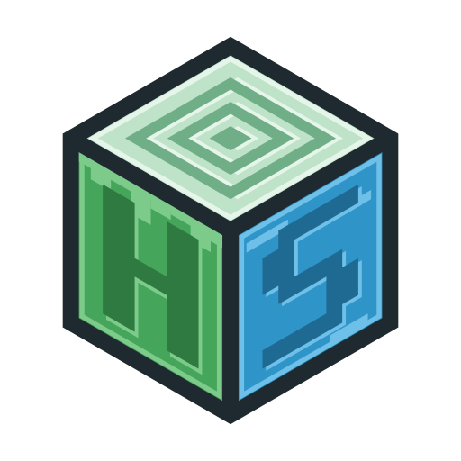
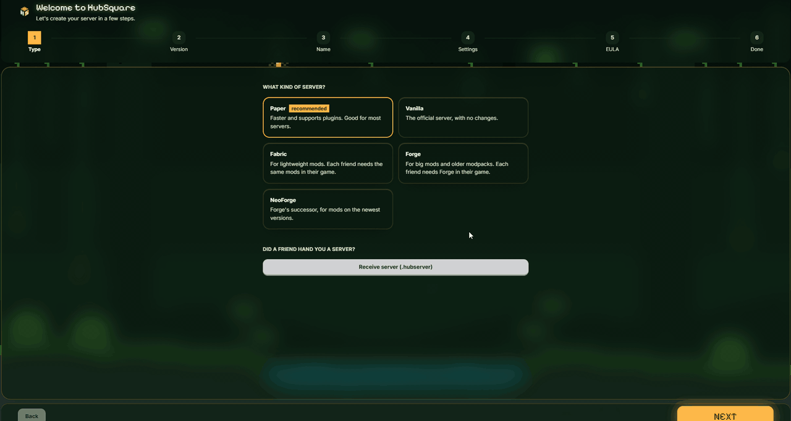
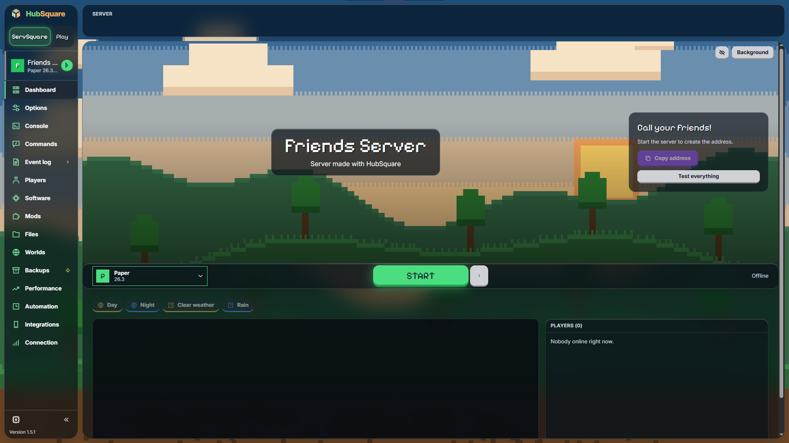
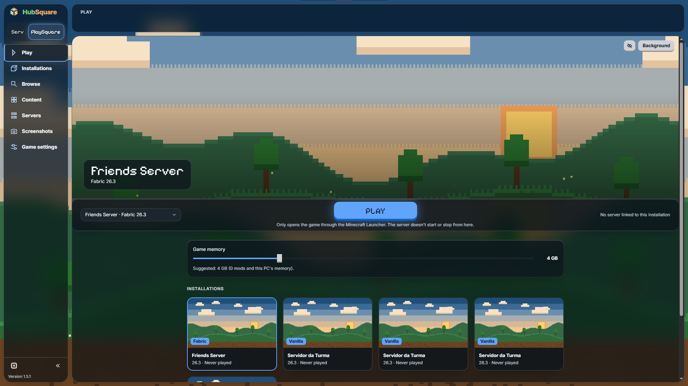
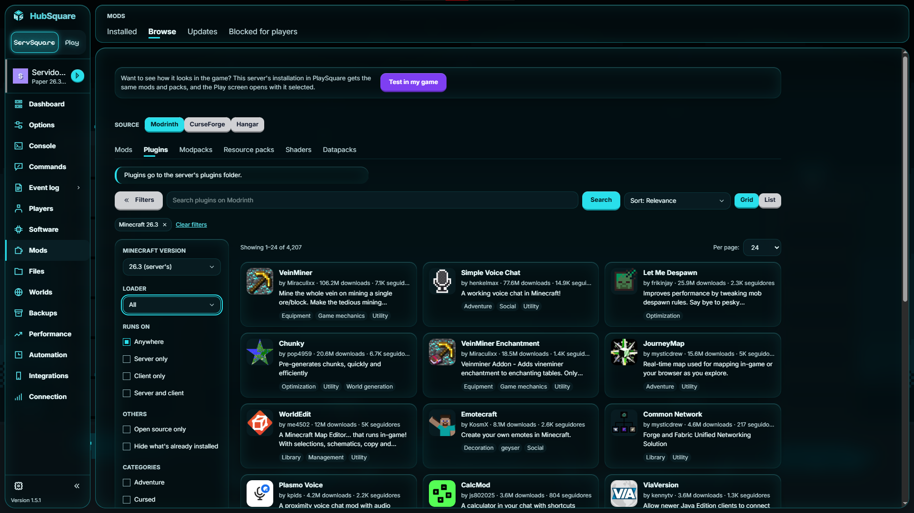
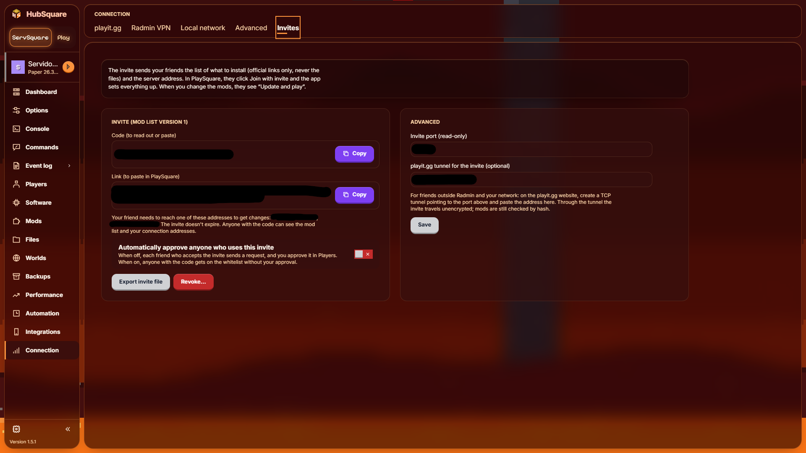
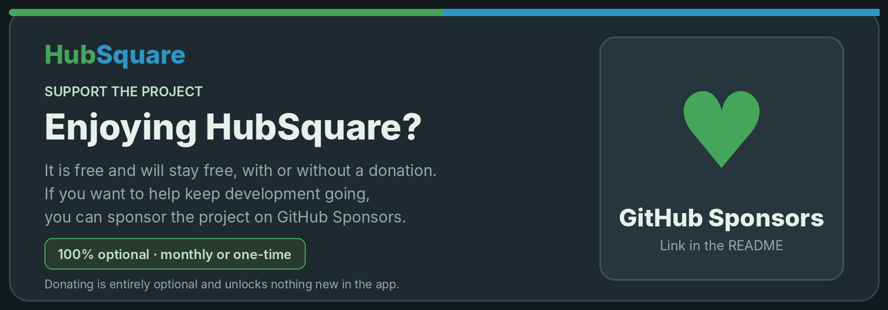

<p align="center">
  
</p>
<h1 align="center">
  <picture>
    <source media="(prefers-color-scheme: dark)" srcset="docs/marca/wordmark-escuro.png">
    
  </picture>
</h1>

<p align="center"><strong>Host a Minecraft Java server on your PC and play with friends, with the same mods for everyone.</strong></p>

<p align="center">
  <a href="https://github.com/lipeventura777/hubsquare/releases/latest"></a>
  <a href="https://github.com/lipeventura777/hubsquare/releases"></a>
  <a href="LICENSE"></a>
  
  
</p>

<p align="center">
  <a href="https://github.com/lipeventura777/hubsquare/releases/latest"></a>
</p>

<p align="center"><a href="README.md">Português (Brasil)</a> · <strong>English</strong></p>

<p align="center"><sub>NOT AN OFFICIAL MINECRAFT PRODUCT. NOT APPROVED BY OR ASSOCIATED WITH MOJANG OR MICROSOFT.</sub></p>

<p align="center">
  
</p>

<table>
  <tr>
    <td></td>
    <td></td>
  </tr>
  <tr>
    <td></td>
    <td></td>
  </tr>
</table>

## What it is

HubSquare is a free Windows app with two areas. **ServSquare** creates, sets up and runs a Minecraft: Java Edition server on your PC, without editing files or using the command line. **PlaySquare** gets each friend's game ready with the same mods, packs and server address, and always opens the game through the **official Minecraft Launcher**, with each player's own account.

## Highlights

| Feature | What it does |
| --- | --- |
| Setup wizard | Pick type, version, name and settings step by step; the Minecraft EULA is only accepted when you check the box. |
| Five server types | Paper, Vanilla, Fabric, Forge (1.7.10 and newer) and NeoForge, downloaded only from the official sources. |
| Automatic Java | Downloads the right Java (Eclipse Temurin) for each Minecraft version. |
| Mods, plugins and modpacks | Search and install from Modrinth and Hangar, with every download checked by hash; imports `.mrpack` modpacks. |
| Invites for friends | A code or link gets a friend's game ready with the same mods and the server address, and tells them when something changed. |
| Connecting with friends | playit.gg tunnel, Radmin VPN or local network, with "Copy address" and a test that tells you what is blocking the connection. |
| Backups | A backup every time the server stops, scheduled backups, and locked backups that are never deleted automatically. |
| Automation | Stops when empty and restarts at a set time, warning players in chat first. |
| Commands center | Time, weather, game rules, items, effects and messages with buttons, plus a console with autocomplete and history. |
| Players | Whitelist, operators, bans, join requests, and each player's inventory and statistics. |
| Phone dashboard | Start, stop and follow the server from your phone, only on your home network, Radmin or Tailscale, with a PIN. |
| Error report | Builds a `.zip` with the logs, without passwords, tokens, worlds or mods, for you to attach when asking for help. |
| App updates | Downloads the new version in the background and only installs when nothing is running. |
| Portuguese and English | The whole app in both languages; switch at any time. |

## How to install

1. Open the [latest release](https://github.com/lipeventura777/hubsquare/releases/latest) page.
2. Under **Assets**, download `HubSquare-Setup-<version>.exe`. To check the file, also download `SHA256SUMS.txt`.
3. Run the installer, choose the language and the folder (or keep the default) and click **Install**.
4. Open HubSquare from the shortcut and choose how you'll use it: **I'll host servers** or **I'll just play with friends**.

### Check the file

The installer is not digitally signed yet. Signing is on the way, through SignPath Foundation's free program for open-source projects (see the [code signing policy](CODE_SIGNING_POLICY.md)). Until then, it's worth checking the file before you install it:

- **With SHA-256:** in PowerShell, in the folder where you downloaded the file, run the command below and compare the result with the line for the same file in the release's `SHA256SUMS.txt`. If it's different, don't install it; download it again.

  ```powershell
  Get-FileHash .\HubSquare-Setup-<version>.exe -Algorithm SHA256
  ```

- **With VirusTotal:** each version's release notes link to the VirusTotal scan of the installer. You can also upload the file at [virustotal.com](https://www.virustotal.com) and compare the SHA-256 it shows.

### Updates

When a new version comes out, the app downloads it in the background and shows "Version X ready" inside the app. It installs when you click **Restart and update** or when you close the app, and never while a server is running, a backup is in progress, a modpack is installing or the game is being prepared. You can skip a version or turn this off in Options › General › Updates.

## Getting started

### Create and start a server

1. On first launch, choose **I'll host servers**. The wizard asks for the type, version, name and settings, and you accept the Minecraft EULA.
2. On the Dashboard, click **START**. The app downloads what's missing (server and Java) and shows the console.
3. Open **Connection**, choose how your friends will join and click **Copy address**.

### Play with friends

- **playit.gg (default):** creates a public address without opening a port on your router. The app downloads the agent and asks you to sign in to playit.gg only once.
- **Radmin VPN:** you and your friends join the same Radmin network; the app shows your Radmin IP (`26.x.x.x`) and can allow Java through the Firewall.
- **Local network:** for people in the same house, on the same Wi-Fi.

To keep everyone's mods the same, use **Connection › Invites › Invite friends** and send the code or the link. Your friend opens it in PlaySquare (**Join with invite**), and the app gets their game ready. If someone can't join, the **Test everything** button (or **I can't connect**, on the friend's side) tells you what's blocking it.

## Requirements

- Windows 10 or 11, 64-bit.
- An original (purchased) copy of Minecraft: Java Edition and the official Minecraft Launcher installed, to play.
- Internet to download the server, Java, mods and updates.
- Memory: the app suggests how much to give the server and the game based on your PC's memory.

## Privacy

- No account of its own, no ads, no usage analytics and no telemetry.
- The app only talks to the official service behind each feature (Mojang, PaperMC, Modrinth, Adoptium, GitHub and others), listed in [PRIVACY.md](PRIVACY.md).
- The phone dashboard is off by default, protected by a PIN, and only answers on your local network, Radmin VPN and Tailscale. It is never open to the internet.
- The error report stays on your Desktop; the app never sends anything on its own.

## FAQ

<details>
<summary>Do I need an original copy of Minecraft?</summary>

Yes. The game opens through the official Minecraft Launcher, with your account. HubSquare never signs in to your Microsoft account and has no offline (cracked) mode.
</details>

<details>
<summary>Do my friends need to install HubSquare?</summary>

It's not required: on a server without mods, they join with the address, straight from Minecraft. With mods, PlaySquare and the invite make their game match the server without manual work.
</details>

<details>
<summary>Does the server stop if I close the window?</summary>

No. When you close the window, the app goes to the Windows tray and the server keeps running. To stop it, use the server button or the tray menu.
</details>

<details>
<summary>Does it work with Bedrock, Mac or Linux?</summary>

No. For now HubSquare is only for Minecraft: Java Edition, on Windows.
</details>

<details>
<summary>Where are my servers and worlds?</summary>

In `Documents\HubSquare` (you can change the folder). The app's settings are in `%APPDATA%\HubSquare`. Uninstalling the app doesn't delete these folders.
</details>

<details>
<summary>I used ServSquare 1.4.0. Will I lose anything?</summary>

No. Install the new version over it. On first launch, the app moves `%APPDATA%\ServSquare` and `Documents\ServSquare` to the new names, with servers, worlds, backups, installations and backgrounds. If a folder is in use, nothing is deleted: the app uses the old folders that time and tries again next time.
</details>

<details>
<summary>What about CurseForge?</summary>

It shows as "coming soon". Mods, plugins and modpacks currently come from Modrinth and Hangar.
</details>


## Roadmap

- Digitally signed installer (SignPath Foundation).
- CurseForge in Browse, with the app's official key.
- A Microsoft Store version, after testing the MSIX package.
- A full `server.properties` editor.

Each version's history is in [CHANGELOG.md](CHANGELOG.md).

## Support

- In the app: **Gear › About › Report a problem** (also in the tray menu and in "See details" on any error). It opens the message already filled in and builds the error report to attach.
- On GitHub: open an [issue](https://github.com/lipeventura777/hubsquare/issues/new/choose) (bug, suggestion or modpack problem).
- Security problem: don't open a public issue; see [SECURITY.md](SECURITY.md).

Want to help with the code? See [CONTRIBUTING.md](CONTRIBUTING.md).

<!-- SPONSORS-EN-INICIO
## Support the project

> **Donating is entirely optional and unlocks nothing new in the app. HubSquare is and will stay free.**

<p align="center">
  <a href="https://github.com/sponsors/[USUARIO_GITHUB]"></a>
</p>

**[Support HubSquare on GitHub Sponsors](https://github.com/sponsors/[USUARIO_GITHUB])**
SPONSORS-EN-FIM -->

## License

[GNU General Public License v3.0 or later](LICENSE) (`GPL-3.0-or-later`). Third-party components and fonts: [THIRD_PARTY_NOTICES.md](THIRD_PARTY_NOTICES.md).

The HubSquare name and logo are not covered by the license (trademark registration pending at INPI, Brazil). You may copy and change the code under the GPL, but a modified version must use a different name and logo. Details in [TRADEMARK.md](TRADEMARK.md).

---

<sub>NOT AN OFFICIAL MINECRAFT PRODUCT. NOT APPROVED BY OR ASSOCIATED WITH MOJANG OR MICROSOFT.<br>
NÃO É UM PRODUTO OFICIAL MINECRAFT. NÃO APROVADO NEM ASSOCIADO À MOJANG OU À MICROSOFT.<br>
Mod, plugin and modpack names, descriptions and images belong to their authors and are shown as provided by Modrinth and Hangar.</sub>
