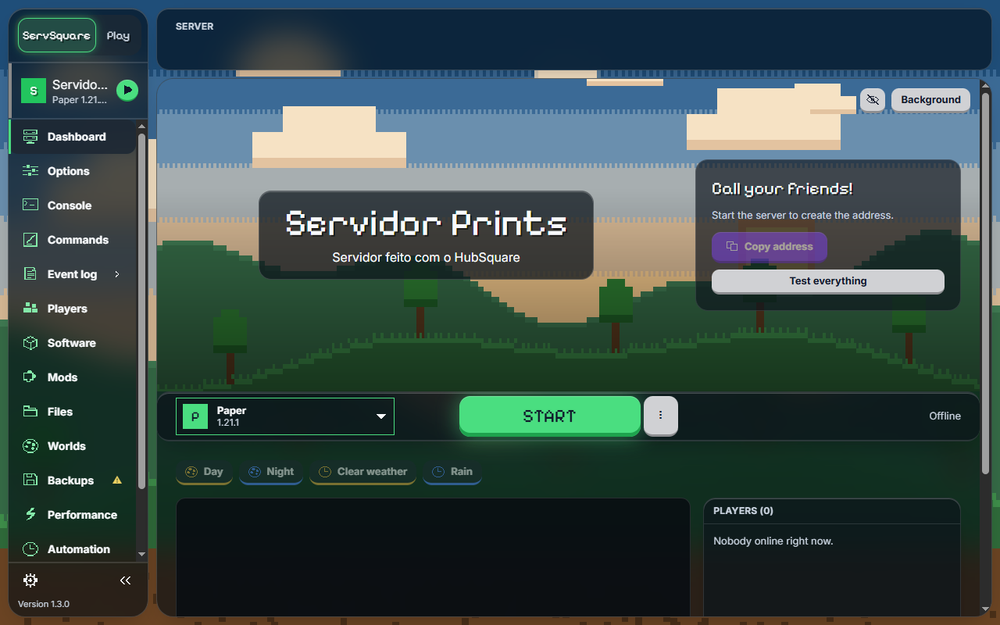
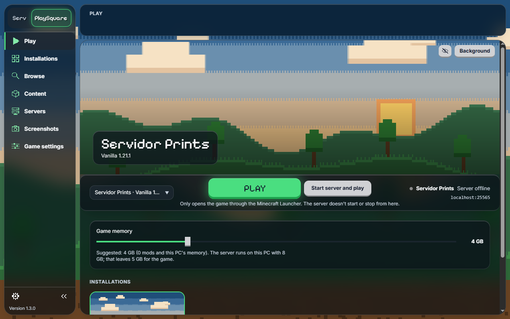

<p align="center">
  
</p>
<h1 align="center">
  <picture>
    <source media="(prefers-color-scheme: dark)" srcset="docs/marca/wordmark-escuro.png">
    
  </picture>
</h1>

[Português (Brasil)](README.pt-BR.md) · **English**

A Windows desktop app for **Minecraft: Java Edition**, made to play with friends. It has two areas:

- **ServSquare** — create, set up and run a server on your own PC: Paper, Vanilla, Fabric, Forge and NeoForge; mods, plugins and modpacks from Modrinth (and, optionally, CurseForge and Hangar); automatic backups; stop when empty, scheduled restarts and backups; connection through a playit.gg tunnel, Radmin VPN or your local network; a dashboard for your phone on your home network.
- **PlaySquare** — sets up each friend's game with the same mods, packs and server address (through an invite), and also works for playing alone. The game opens through the **official Minecraft Launcher**, with your own account.

HubSquare never signs in to your Microsoft account and has no offline (cracked) mode. You need to own Minecraft: Java Edition. The app is available in **English** and **Brazilian Portuguese** (pick it in the installer, on first launch, or later under the gear › Idioma / Language).




## Features

- Server creation wizard; the Minecraft EULA is only accepted when **you** check the box.
- Official sources only: Mojang, PaperMC, FabricMC, MinecraftForge, NeoForged, Eclipse Temurin (Adoptium), Modrinth, CurseForge, Hangar. Every download is checked by hash.
- Mods: browse, install, update, enable/disable, profiles, config editor, crash suspects.
- Worlds, backups (with lock), players (whitelist, OPs, bans, inventory, statistics), commands center, console with autocomplete.
- Invites: friends get a list of official links + hashes (never the files) and the server address.
- Files whose authors don't allow third-party downloads are never downloaded by the app: it opens the official page and picks up the file you download yourself.
- Connection diagnosis, error reports without secrets, phone dashboard (local network, Radmin and Tailscale only).

## Install

1. Open the [**Releases**](https://github.com/lipeventura777/hubsquare/releases/latest) page and download `HubSquare-Setup-<version>.exe` (and, if you want, `SHA256SUMS.txt` to check it).
2. Run the installer, choose the language and the folder (or keep the default).

**Coming from 1.4.0 or older?** Just install the new version over it. The installer removes the old entry from Windows (your data stays), and on first launch the app moves `%APPDATA%\ServSquare` and `Documents\ServSquare` to `%APPDATA%\HubSquare` and `Documents\HubSquare`, with everything inside: servers, worlds, backups, installations, mods and backgrounds. If a folder is in use, nothing is deleted: the app keeps the old folders for that session and tries again next time.

### Updates

When a new version comes out on GitHub, the app downloads it in the background and shows "Version X ready" inside the app (never a Windows notification). It installs when you click **Restart and update** or when you close the app, and never while a server is running, a backup is being made, a modpack is installing or PLAY is getting the game ready: it waits and tells you why. You can skip a version, and turn automatic updates off in Options › General › Updates. Each release on GitHub has the installer, the update files and a `SHA256SUMS.txt`.

### Windows SmartScreen

The installer is not code-signed yet, so Windows may show **"Windows protected your PC"**. To continue, click **More info › Run anyway**. See the [code signing policy](CODE_SIGNING_POLICY.md).

## Build from source

You need [Node.js](https://nodejs.org) 22 or newer, on Windows.

```bash
npm ci
npm run dev
```

| Script | What it does |
|---|---|
| `npm run dev` | opens the app in development mode |
| `npm run build` | type-checks and compiles to `out/` |
| `npm run lint` | ESLint plus the check for hard-coded UI text (`scripts/checar-textos.mjs`) |
| `npm test` | unit tests for the pure rules (`tests/*.test.ts`, `node:test`) |
| `npm run test:e2e` | builds and opens the app with Playwright, offline (simulated internet) |
| `npm run test:e2e:lento` | slow end-to-end tests with real Paper and Java downloads |
| `npm run dist` | builds the installer and `SHA256SUMS.txt` in `release/` |
| `npm run format` | formats the code with Prettier |
| `npm run icone` | regenerates `build/icon.ico`, the PNGs in `build/logo/png/`, `resources/` and `docs/marca/` from the two logos in `build/logo/` |
| `npm run ler-relatorio -- <file.zip>` | prints the summary of an error report |
| `npm run repro:modpack -- <mode>` | reproduces modpack installs from the terminal |

Stack: Electron, TypeScript, React, Vite (electron-vite), Tailwind CSS; installer with electron-builder (NSIS). How the code is organized: [docs/ARCHITECTURE.md](docs/ARCHITECTURE.md). Contributing: [CONTRIBUTING.md](CONTRIBUTING.md).

## Getting help

Found a bug or have an idea? In the app, open **Gear › About › Report a problem** (or the tray menu, or "See details" on any error). Pick the type, describe what happened and choose **Send by email** or **Open on GitHub**: both open already filled in, with an error report `.zip` (no secrets, worlds or mod files) ready to attach. You can also email suporte.hubsquare@gmail.com or open an [issue](https://github.com/lipeventura777/hubsquare/issues) directly.

## Privacy and security

HubSquare has no account, no analytics and no telemetry. It only talks to the official services listed in [PRIVACY.md](PRIVACY.md). To report a vulnerability, see [SECURITY.md](SECURITY.md).

## License

[GNU General Public License v3.0 or later](LICENSE) (`GPL-3.0-or-later`). Third-party components and fonts: [THIRD_PARTY_NOTICES.md](THIRD_PARTY_NOTICES.md).

## Trademark

The HubSquare name and logo are not covered by the license (trademark registration pending at INPI, Brazil). You may fork and change the code under the GPL, but a modified version must use a different name and logo.

## Disclaimer

NOT AN OFFICIAL MINECRAFT PRODUCT. NOT APPROVED BY OR ASSOCIATED WITH MOJANG OR MICROSOFT.

Mod, plugin and modpack names, descriptions and images belong to their authors and are shown as provided by Modrinth, CurseForge and Hangar.
