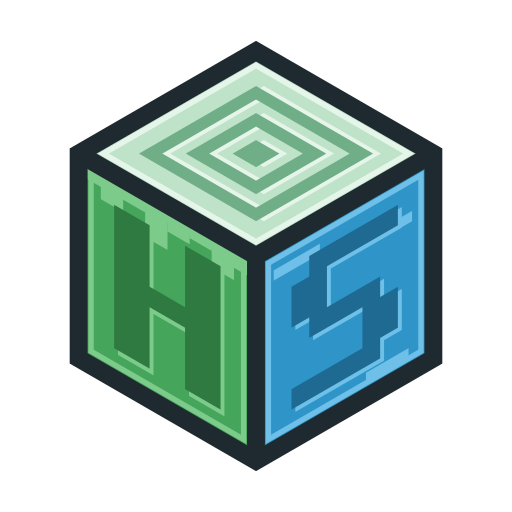
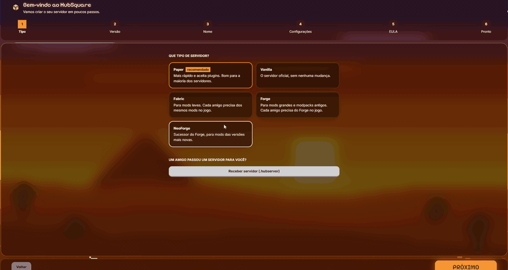
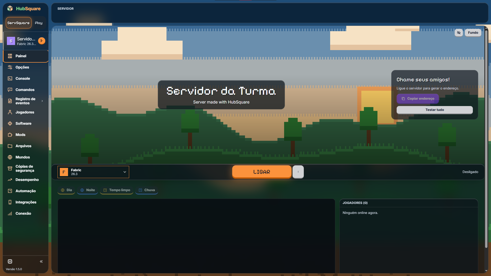
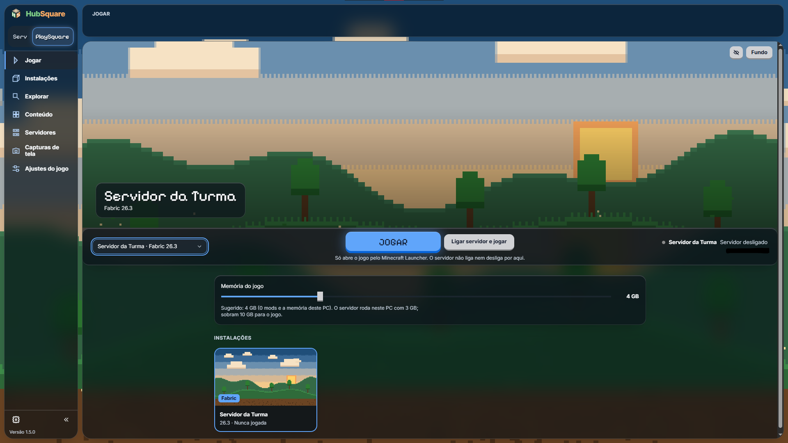
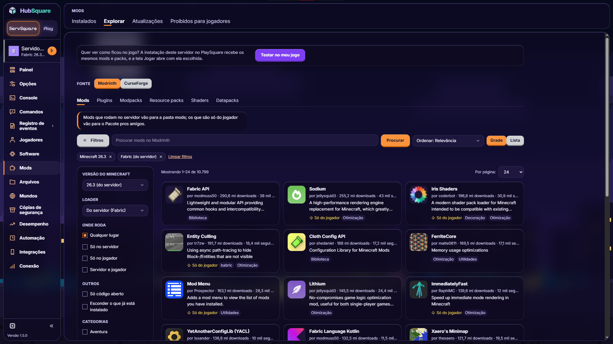
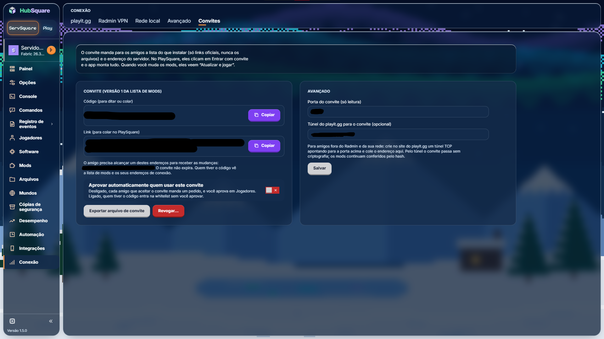

<p align="center">
  
</p>
<h1 align="center">
  <picture>
    <source media="(prefers-color-scheme: dark)" srcset="docs/marca/wordmark-escuro.png">
    
  </picture>
</h1>

<p align="center"><strong>Crie um servidor de Minecraft Java no seu PC e jogue com os amigos, com os mesmos mods para todo mundo.</strong></p>

<p align="center">
  <a href="https://github.com/lipeventura777/hubsquare/releases/latest"></a>
  <a href="https://github.com/lipeventura777/hubsquare/releases"></a>
  <a href="LICENSE"></a>
  
  
</p>

<p align="center">
  <a href="https://github.com/lipeventura777/hubsquare/releases/latest"></a>
</p>

<p align="center"><strong>Português (Brasil)</strong> · <a href="README.en.md">English</a></p>

<p align="center">
  
</p>

<table>
  <tr>
    <td></td>
    <td></td>
  </tr>
  <tr>
    <td></td>
    <td></td>
  </tr>
</table>

## O que é

O HubSquare é um app gratuito para Windows com duas áreas. O **ServSquare** cria, configura e liga um servidor de Minecraft: Java Edition no seu PC, sem mexer em arquivos nem em linha de comando. O **PlaySquare** prepara o jogo de cada amigo com os mesmos mods, packs e endereço do servidor, e abre o jogo sempre pelo **Minecraft Launcher oficial**, com a conta de cada um.

## Destaques

| Recurso | O que faz |
| --- | --- |
| Assistente de criação | Escolhe tipo, versão, nome e configurações passo a passo; o EULA do Minecraft só é aceito quando você marca a caixa. |
| Cinco tipos de servidor | Paper, Vanilla, Fabric, Forge (do 1.7.10 em diante) e NeoForge, baixados só das fontes oficiais. |
| Java automático | Baixa a versão certa do Java (Eclipse Temurin) para cada versão do Minecraft. |
| Mods, plugins e modpacks | Busca e instala do Modrinth e do Hangar, com cada download conferido pelo hash; importa modpacks `.mrpack`. |
| Convites para os amigos | Um código ou link prepara o jogo do amigo com os mesmos mods e o endereço do servidor, e avisa quando algo mudou. |
| Conexão com os amigos | Túnel do playit.gg, Radmin VPN ou rede local, com "Copiar endereço" e um teste que diz o que impede a entrada. |
| Backups | Um backup a cada vez que o servidor desliga, backup agendado e backups protegidos que nunca são apagados sozinhos. |
| Automação | Desliga quando fica vazio e reinicia em horário marcado, avisando no chat antes. |
| Central de comandos | Tempo, clima, regras do jogo, itens, efeitos e mensagens com botões, e console com autocompletar e histórico. |
| Jogadores | Whitelist, operadores, banidos, pedidos para entrar, inventário e estatísticas de cada jogador. |
| Painel pelo celular | Liga, desliga e acompanha o servidor pelo celular, só na rede de casa, no Radmin ou no Tailscale, com PIN. |
| Relatório de erro | Gera um `.zip` com os registros, sem senhas, tokens, mundos nem mods, para você anexar quando pedir ajuda. |
| Atualização do app | Baixa a versão nova em segundo plano e só instala quando nada está rodando. |
| Português e inglês | O app inteiro nas duas línguas; dá para trocar a qualquer hora. |

## Como instalar

1. Abra a página da [última versão](https://github.com/lipeventura777/hubsquare/releases/latest).
2. Em **Assets**, baixe o `HubSquare-Setup-<versão>.exe`. Se quiser conferir o arquivo, baixe também o `SHA256SUMS.txt`.
3. Abra o instalador, escolha o idioma e a pasta (ou deixe a padrão) e clique em **Instalar**.
4. Abra o HubSquare pelo atalho e escolha como vai usar o app: **Vou hospedar servidores** ou **Só vou jogar com amigos**.

### Conferir o arquivo

O instalador ainda não tem assinatura digital. A assinatura está a caminho, pelo programa gratuito da SignPath Foundation para projetos de código aberto (veja a [política de assinatura de código](CODE_SIGNING_POLICY.md)). Até lá, vale conferir o arquivo antes de instalar:

- **Pelo SHA-256:** no PowerShell, na pasta onde o arquivo foi baixado, rode o comando abaixo e compare o resultado com a linha do mesmo arquivo no `SHA256SUMS.txt` da release. Se for diferente, não instale e baixe de novo.

  ```powershell
  Get-FileHash .\HubSquare-Setup-<versão>.exe -Algorithm SHA256
  ```

- **Pelo VirusTotal:** a nota de cada versão traz o link da análise do instalador no VirusTotal. Você também pode enviar o arquivo em [virustotal.com](https://www.virustotal.com) e comparar o SHA-256 que aparece lá.

### Atualizações

Quando sai uma versão nova, o app baixa em segundo plano e mostra "Versão X pronta" dentro do app. Ela instala quando você clica em **Reiniciar e atualizar** ou quando fecha o app, e nunca com um servidor ligado, um backup em andamento, um modpack instalando ou o jogo sendo preparado. Dá para pular uma versão ou desligar em Opções › Gerais › Atualizações.

## Primeiros passos

### Criar e ligar um servidor

1. Na primeira abertura, escolha **Vou hospedar servidores**. O assistente pede o tipo, a versão, o nome e as configurações, e você aceita o EULA do Minecraft.
2. No Painel, clique em **LIGAR**. O app baixa o que falta (servidor e Java) e mostra o console.
3. Abra **Conexão**, escolha como seus amigos vão entrar e clique em **Copiar endereço**.

### Jogar com os amigos

- **playit.gg (padrão):** cria um endereço público sem abrir porta no roteador. O app baixa o agente e pede o login do playit.gg uma vez só.
- **Radmin VPN:** você e os amigos entram na mesma rede do Radmin; o app mostra o seu IP do Radmin (`26.x.x.x`) e pode liberar o Java no Firewall.
- **Rede local:** para quem está na mesma casa, no mesmo Wi-Fi.

Para os mods ficarem iguais para todo mundo, use **Conexão › Convites › Convidar amigos** e mande o código ou o link. O amigo abre no PlaySquare (**Entrar com convite**), e o app prepara o jogo dele. Se alguém não conseguir entrar, o botão **Testar tudo** (ou **Não consigo entrar**, do lado do amigo) diz o que está impedindo.

## Requisitos

- Windows 10 ou 11, 64 bits.
- Minecraft: Java Edition original (comprado) e o Minecraft Launcher oficial instalado, para jogar.
- Internet para baixar o servidor, o Java, os mods e as atualizações.
- Memória: o app sugere quanto dar ao servidor e ao jogo pela memória do seu PC.

## Privacidade

- Sem conta própria, sem anúncios, sem análise de uso e sem telemetria.
- O app só fala com os serviços oficiais de cada recurso (Mojang, PaperMC, Modrinth, Adoptium, GitHub e outros), listados em [PRIVACY.pt-BR.md](PRIVACY.pt-BR.md).
- O painel do celular vem desligado, é protegido por PIN e só responde na rede local, no Radmin VPN e no Tailscale. Ele nunca fica aberto na internet.
- O relatório de erro fica na sua Área de Trabalho; o app nunca envia nada sozinho.

## Perguntas frequentes

<details>
<summary>Preciso ter o Minecraft original?</summary>

Sim. O jogo abre pelo Minecraft Launcher oficial, com a sua conta. O HubSquare não faz login na sua conta da Microsoft e não tem modo sem conta original (pirata).
</details>

<details>
<summary>Meus amigos precisam instalar o HubSquare?</summary>

Não é obrigatório: num servidor sem mods, eles entram pelo endereço, direto no Minecraft. Com mods, o PlaySquare e o convite deixam o jogo deles igual ao servidor sem trabalho manual.
</details>

<details>
<summary>O servidor desliga se eu fechar a janela?</summary>

Não. Ao fechar a janela, o app vai para a bandeja do Windows e o servidor continua ligado. Para desligar, use o botão do servidor ou o menu da bandeja.
</details>

<details>
<summary>Funciona com Bedrock, Mac ou Linux?</summary>

Não. Por enquanto o HubSquare é só para Minecraft: Java Edition, no Windows.
</details>

<details>
<summary>Onde ficam meus servidores e mundos?</summary>

Em `Documentos\HubSquare` (dá para mudar a pasta). Os ajustes do app ficam em `%APPDATA%\HubSquare`. Desinstalar o app não apaga essas pastas.
</details>

<details>
<summary>Eu usava o ServSquare 1.4.0. Perco alguma coisa?</summary>

Não. Instale a versão nova por cima. Na primeira abertura, o app passa `%APPDATA%\ServSquare` e `Documentos\ServSquare` para os nomes novos, com servidores, mundos, backups, instalações e fundos. Se alguma pasta estiver em uso, nada é apagado: o app usa as pastas antigas naquela vez e tenta de novo na próxima.
</details>

<details>
<summary>E o CurseForge?</summary>

Aparece como "em breve". Os mods, plugins e modpacks vêm hoje do Modrinth e do Hangar.
</details>


## Roadmap

- Assinatura digital do instalador (SignPath Foundation).
- CurseForge no Explorar, com a chave oficial do app.
- Versão na Microsoft Store, depois de testar o pacote MSIX.
- Editor completo do `server.properties`.

O histórico de cada versão está no [CHANGELOG.md](CHANGELOG.md).

## Suporte

- No app: **Engrenagem › Sobre › Relatar problema** (também no menu da bandeja e no "Ver detalhes" de qualquer erro). Ele abre a mensagem já preenchida e gera o relatório de erro para anexar.
- No GitHub: abra uma [issue](https://github.com/lipeventura777/hubsquare/issues/new/choose) (bug, sugestão ou problema com modpack).
- Falha de segurança: não abra issue pública; veja [SECURITY.md](SECURITY.md).

Quer ajudar no código? Veja [CONTRIBUTING.md](CONTRIBUTING.md).

## Doações

O HubSquare é gratuito e vai continuar assim. A forma de doar ainda está sendo escolhida; quando existir, o botão **Sponsor** aparece no topo do repositório.

## Licença

[GNU General Public License v3.0 ou posterior](LICENSE) (`GPL-3.0-or-later`). Componentes e fontes de terceiros: [THIRD_PARTY_NOTICES.md](THIRD_PARTY_NOTICES.md).

O nome e o logo HubSquare não são cobertos pela licença (marca em registro no INPI). Você pode copiar e mudar o código seguindo a GPL, mas uma versão modificada precisa usar outro nome e outro logo.

---

<sub>NÃO É UM PRODUTO OFICIAL DO MINECRAFT. NÃO APROVADO PELA OU ASSOCIADO À MOJANG OU MICROSOFT.<br>
Nomes, descrições e imagens de mods, plugins e modpacks são dos seus autores e aparecem como vêm do Modrinth e do Hangar.</sub>
