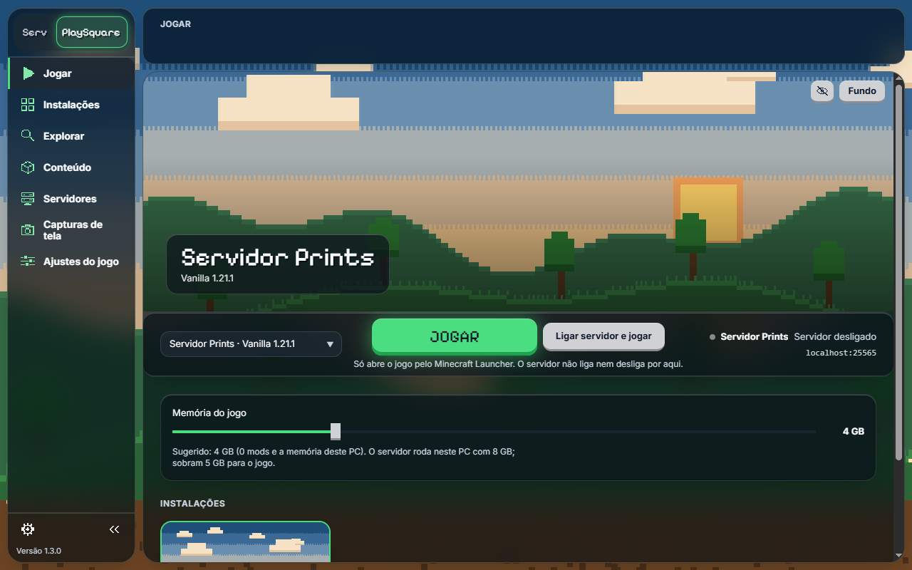

# HubSquare

**Português (Brasil)** · [English](README.md)

App de desktop para **Minecraft: Java Edition** no Windows, para jogar com os amigos. Tem duas áreas:

- **ServSquare** — cria, configura e liga um servidor no seu PC: Paper, Vanilla, Fabric, Forge e NeoForge; mods, plugins e modpacks do Modrinth (e, opcionalmente, do CurseForge e do Hangar); backups automáticos; desligar quando vazio, reinício e backup agendados; conexão por túnel do playit.gg, Radmin VPN ou rede local; painel pelo celular na rede de casa.
- **PlaySquare** — prepara o jogo de cada amigo com os mesmos mods, packs e endereço do servidor (por convite), e também serve para jogar sozinho. O jogo abre pelo **Minecraft Launcher oficial**, com a sua conta.

O HubSquare não faz login na conta da Microsoft e não tem modo sem conta original. Você precisa ter o Minecraft: Java Edition. O app é em **português** e em **inglês** (escolha no instalador, na primeira abertura ou depois na engrenagem › Idioma / Language).




## Instalar

1. Abra a página de [**Releases**](https://github.com/lipeventura777/hubsquare/releases/latest) e baixe o `HubSquare-Setup-<versão>.exe` (e, se quiser conferir, o `SHA256SUMS.txt`).
2. Execute o instalador, escolha o idioma e a pasta (ou deixe a padrão).

Quando sair uma versão nova, o próprio app avisa (dá para desligar). Ele só abre a página para baixar; nada é instalado sozinho.

### Aviso do Windows (SmartScreen)

O instalador ainda não tem assinatura digital, então o Windows pode mostrar **"O Windows protegeu o computador"**. Para continuar, clique em **Mais informações › Executar assim mesmo**. Veja a [política de assinatura de código](CODE_SIGNING_POLICY.md).

## Rodar o código

Precisa do [Node.js](https://nodejs.org) 22 ou mais novo, no Windows.

```bash
npm ci
npm run dev
```

Os comandos (`npm run build`, `npm run lint`, `npm test`, `npm run test:e2e`, `npm run dist`...) estão explicados no [README em inglês](README.md#build-from-source). Como o código se organiza: [docs/ARCHITECTURE.md](docs/ARCHITECTURE.md). Como lançar uma versão: [docs/como-lancar-versao.md](docs/como-lancar-versao.md).

## Privacidade e segurança

O HubSquare não tem conta própria, análise de uso nem telemetria. Ele só fala com os serviços oficiais listados em [PRIVACY.pt-BR.md](PRIVACY.pt-BR.md). Para relatar uma falha de segurança, veja [SECURITY.md](SECURITY.md).

## Licença

[MIT](LICENSE). Componentes e fontes de terceiros: [THIRD_PARTY_NOTICES.md](THIRD_PARTY_NOTICES.md).

## Aviso

NÃO É UM PRODUTO OFICIAL DO MINECRAFT. NÃO É APROVADO PELA MOJANG OU PELA MICROSOFT NEM ASSOCIADO A ELAS.

Nomes, descrições e imagens de mods, plugins e modpacks são dos seus autores e aparecem como vêm do Modrinth, do CurseForge e do Hangar.
