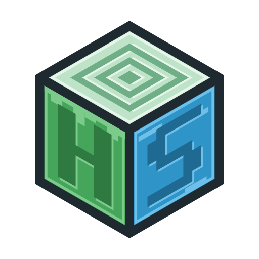
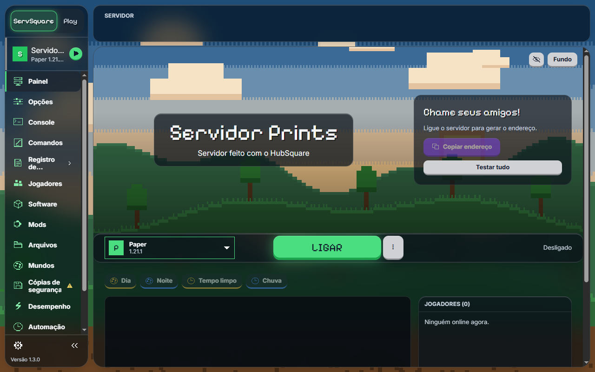

<p align="center">
  
</p>
<h1 align="center">
  <picture>
    <source media="(prefers-color-scheme: dark)" srcset="docs/marca/wordmark-escuro.png">
    
  </picture>
</h1>

**Português (Brasil)** · [English](README.md)

App de desktop para **Minecraft: Java Edition** no Windows, para jogar com os amigos. Tem duas áreas:

- **ServSquare** — cria, configura e liga um servidor no seu PC: Paper, Vanilla, Fabric, Forge e NeoForge; mods, plugins e modpacks do Modrinth (e, opcionalmente, do CurseForge e do Hangar); backups automáticos; desligar quando vazio, reinício e backup agendados; conexão por túnel do playit.gg, Radmin VPN ou rede local; painel pelo celular na rede de casa.
- **PlaySquare** — prepara o jogo de cada amigo com os mesmos mods, packs e endereço do servidor (por convite), e também serve para jogar sozinho. O jogo abre pelo **Minecraft Launcher oficial**, com a sua conta.

O HubSquare não faz login na conta da Microsoft e não tem modo sem conta original. Você precisa ter o Minecraft: Java Edition. O app é em **português** e em **inglês** (escolha no instalador, na primeira abertura ou depois na engrenagem › Idioma / Language).




## Instalar

1. Abra a página de [**Releases**](https://github.com/lipeventura777/hubsquare/releases/latest) e baixe o `HubSquare-Setup-<versão>.exe` (e, se quiser conferir, o `SHA256SUMS.txt`).
2. Execute o instalador, escolha o idioma e a pasta (ou deixe a padrão).

**Vindo da 1.4.0 ou anterior?** É só instalar a versão nova por cima. O instalador tira a entrada antiga do Windows (seus dados ficam) e, na primeira abertura, o app passa `%APPDATA%\ServSquare` e `Documentos\ServSquare` para `%APPDATA%\HubSquare` e `Documentos\HubSquare`, com tudo dentro: servidores, mundos, backups, instalações, mods e fundos. Se alguma pasta estiver em uso, nada é apagado: o app usa as pastas antigas naquela vez e tenta de novo na próxima.

### Atualizações

Quando sai uma versão nova no GitHub, o app baixa em segundo plano e mostra "Versão X pronta" dentro do app (nunca notificação do Windows). Ela instala quando você clica em **Reiniciar e atualizar** ou quando fecha o app, e nunca com um servidor ligado, backup em andamento, modpack instalando ou o JOGAR preparando o jogo: o app espera e diz por quê. Dá para pular uma versão e desligar a atualização automática em Opções › Gerais › Atualizações. Cada release no GitHub traz o instalador, os arquivos de atualização e um `SHA256SUMS.txt`.

### Aviso do Windows (SmartScreen)

O instalador ainda não tem assinatura digital, então o Windows pode mostrar **"O Windows protegeu o computador"**. Para continuar, clique em **Mais informações › Executar assim mesmo**. Veja a [política de assinatura de código](CODE_SIGNING_POLICY.md).

## Rodar o código

Precisa do [Node.js](https://nodejs.org) 22 ou mais novo, no Windows.

```bash
npm ci
npm run dev
```

Os comandos (`npm run build`, `npm run lint`, `npm test`, `npm run test:e2e`, `npm run dist`...) estão explicados no [README em inglês](README.md#build-from-source). Como o código se organiza: [docs/ARCHITECTURE.md](docs/ARCHITECTURE.md). Como lançar uma versão: [docs/como-lancar-versao.md](docs/como-lancar-versao.md).

## Pedir ajuda

Achou um bug ou tem uma ideia? No app, abra **Engrenagem › Sobre › Relatar problema** (ou o menu da bandeja, ou "Ver detalhes" de qualquer erro). Escolha o tipo, conte o que aconteceu e clique em **Enviar por e-mail** ou **Abrir no GitHub**: os dois abrem já preenchidos, com o `.zip` do relatório de erro (sem segredos, mundos nem arquivos de mods) pronto para anexar. Também dá para mandar direto para suporte.hubsquare@gmail.com ou abrir uma [issue](https://github.com/lipeventura777/hubsquare/issues).

## Privacidade e segurança

O HubSquare não tem conta própria, análise de uso nem telemetria. Ele só fala com os serviços oficiais listados em [PRIVACY.pt-BR.md](PRIVACY.pt-BR.md). Para relatar uma falha de segurança, veja [SECURITY.md](SECURITY.md).

## Licença

[GNU General Public License v3.0 ou posterior](LICENSE) (`GPL-3.0-or-later`). Componentes e fontes de terceiros: [THIRD_PARTY_NOTICES.md](THIRD_PARTY_NOTICES.md).

## Marca

O nome e o logo HubSquare não são cobertos pela licença (marca em registro no INPI). Você pode copiar e mudar o código seguindo a GPL, mas uma versão modificada precisa usar outro nome e outro logo.

## Aviso

NÃO É UM PRODUTO OFICIAL DO MINECRAFT. NÃO É APROVADO PELA MOJANG OU PELA MICROSOFT NEM ASSOCIADO A ELAS.

Nomes, descrições e imagens de mods, plugins e modpacks são dos seus autores e aparecem como vêm do Modrinth, do CurseForge e do Hangar.
